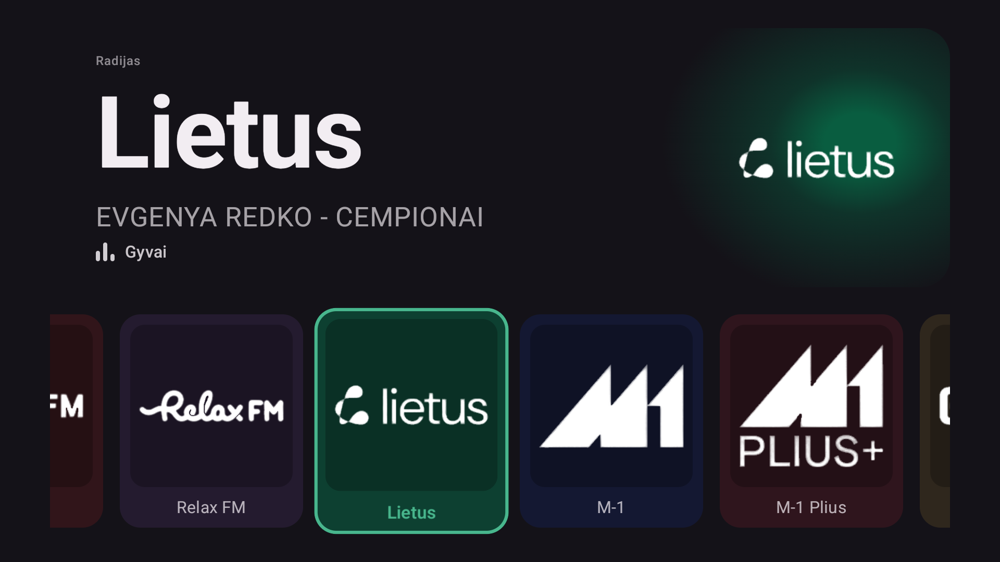
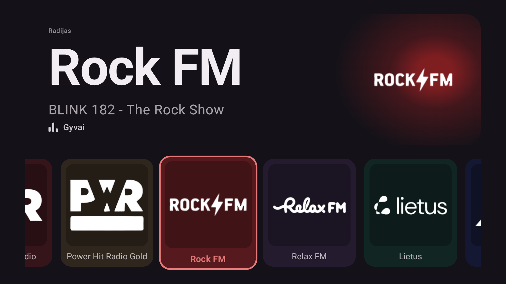
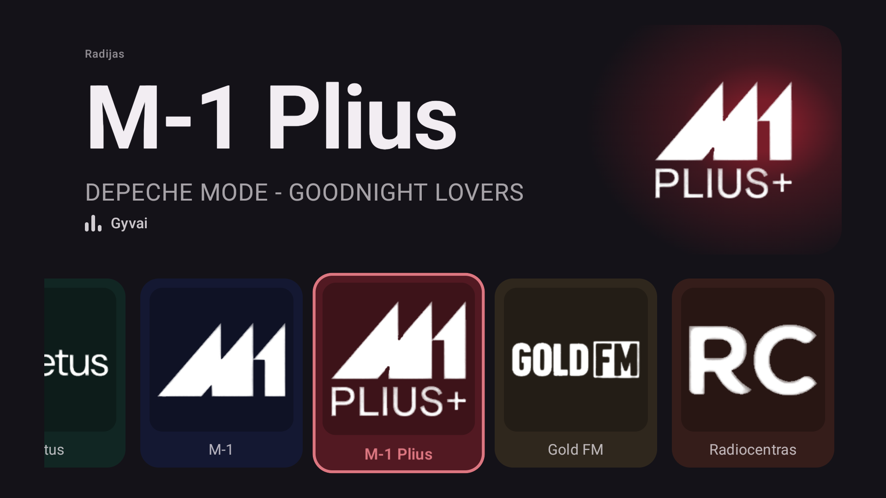
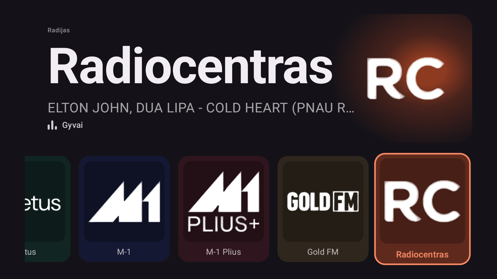

# Radijas

**Android TV radijo programėlė. Įjungi — groja.**

Vienas ekranas, dešimt Lietuvos stočių, jokio meniu. Skirta tiems, kuriems radijas televizoriuje turi įsijungti taip pat paprastai kaip televizijos kanalas.



## Kas tai

Programėlė atsidaro ir iškart groja paskutinę klausytą stotį — pirmą kartą paleidus, Lietus. Nereikia spausti „play", nereikia rinktis profilio, nereikia nieko nustatyti.

Valdymas telpa į keturis pulto mygtukus:

| Mygtukas | Veiksmas |
|---|---|
| ← → | Rinktis stotį |
| OK | Groti |
| Back / Home | Išeiti ir nutildyti |
| ↑ ↓ | Nieko |

Daugiau nieko nėra. Sąmoningai.

## Ekranai

| | |
|---|---|
|  |  |
|  |  |

Spalva ateina iš stoties ženklo: perjungi stotį — persidažo visas ekranas. Logotipai balti, kad būtų įskaitomi iš sofos bet kurioje spalvoje.

## Savybės

- **10 stočių:** ZIP FM, Power Hit Radio, Power Hit Radio Gold, Rock FM, Relax FM, Lietus, M-1, M-1 Plius, Gold FM, Radiocentras.
- **Automatinis prisijungimas iš naujo.** Nutrūkus srautui, bandoma 1 → 2 → 4 → 8 → 15 s, po to kas 30 s, be galo. Naktį dingęs Wi-Fi atsigauna pats.
- **„Kas groja"** — stoties siunčiamas atlikėjas ir daina, kai stotis jį siunčia.
- **Jokių reklamų, analitikos, paskyrų, registracijų.** Vienintelis tinklo srautas — pati radijo stotis.
- **TV-only.** Programėlė pasirodo tik televizoriaus meniu, telefono launcheryje jos nėra.

### Ko sąmoningai nėra

Nėra pauzės mygtuko. Nėra nustatymų ekrano. Nėra mėgstamų sąrašo, paieškos, ekvalaizerio, miego laikmačio. Nėra šviesios temos. Kiekvienas papildomas ekranas yra vieta, kurioje vyresnis žmogus gali pasimesti — todėl jų nėra.

## Įdiegimas

Šiuo metu APK dar nepublikuotas. Statai iš šaltinio:

```bash
git clone https://github.com/afda1/radijas.git
cd radijas
export JAVA_HOME=/kelias/iki/jdk-17      # JDK 17 ar naujesnis
export ANDROID_HOME=/kelias/iki/android-sdk
./gradlew assembleDebug
adb install -r app/build/outputs/apk/debug/app-debug.apk
```

Reikia Android SDK su `platforms;android-37`. Programėlė veikia nuo Android TV 7.0 (`minSdk 24`).

## Kaip tai veikia

Vienas Compose ekranas: nefokusuojama „dabar groja" panelė viršuje ir vienintelė fokusuojama zona — horizontali stočių lentyna apačioje. Fokusas negali „pabėgti" į kitą zoną, nes kitos zonos nėra.

Garsą groja `MediaLibraryService` su ExoPlayer (Media3). Tyčia atsisakyta bet kokio play/pause valdymo — nei programėlėje, nei pranešime, nei per Google Assistant. Jei sistema galėtų tyliai įjungti pauzę, žmogus sėdėtų prie ekrano, kuris rašo „Gyvai", ir nieko negirdėtų.

Pranešime yra tik „Stabdyti". Išėjus į Home ar paspaudus Back, garsas nutyla; televizoriaus screensaveriui įsijungus — groja toliau, kad būtų galima užmigti klausant.

## Apie dizainą

Spalvų paletė nėra fiksuota — ji apskaičiuojama iš kiekvienos stoties ženklo spalvos taip, kad tekstas visada atitiktų WCAG 4.5:1 kontrastą. Tai testuojama automatiškai visoms dešimčiai stočių, o ne tikrinama akimis.

Fokuso rėmelis, saugi zona (5 % ekrano krašto), teksto dydžiai ir „nešokinėjantis" išdėstymas taip pat padengti testais: `app/src/test/` turi 60+ vienetų testų, įskaitant fokuso elgsenos, būsenų ir paletės kontrasto patikras.

## Kreditai ir licencija

**Radijas** platinamas pagal [GPL-3.0-only](LICENSE).

Garso variklis — Media3/ExoPlayer sesijos servisas, automatinio prisijungimo logika, stočių katalogas — kilęs iš [Fogwave](https://github.com/kalarina-bit/Fogwave) (GPL-3.0-only, autorius kalarina-bit). Visa kita — televizoriaus interfeisas, dizaino sistema, fokuso modelis, logotipas ir testai — parašyta šiam projektui.

Kadangi dalis kodo yra išvestinė, visa programėlė lieka GPL-3.0-only: jei platini pakeistą versiją, turi pateikti ir jos išeities kodą.

---

## English

**Radijas** is an Android TV radio app for ten Lithuanian stations. It opens and plays — one screen, four remote buttons, no menus, no accounts, no ads, no analytics.

The palette is derived from each station's brand colour and tested for WCAG 4.5:1 contrast. There is deliberately no pause control anywhere, so the app can never be left silently "playing".

Built on the [Fogwave](https://github.com/kalarina-bit/Fogwave) playback engine (GPL-3.0-only); the TV interface, design system, focus model and tests are original. Licensed GPL-3.0-only.
