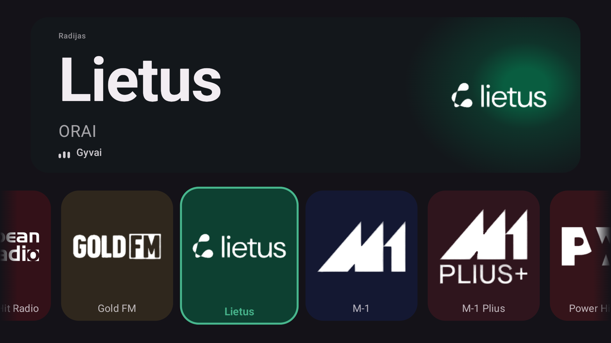
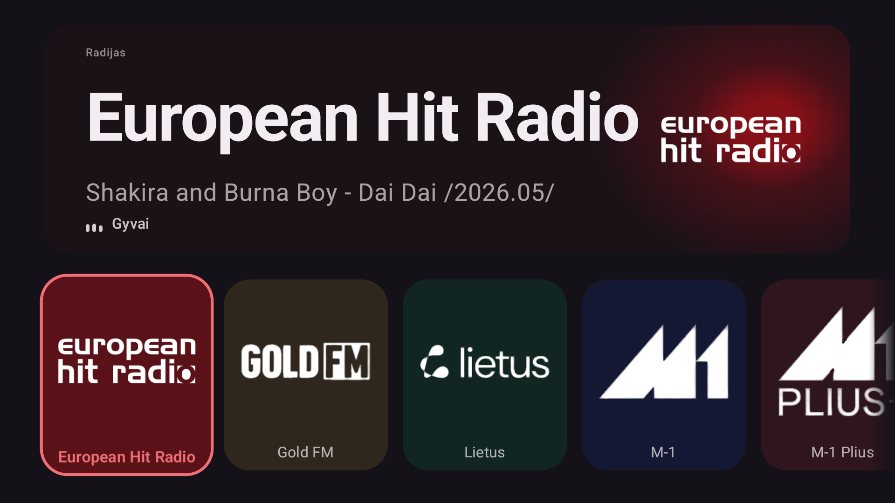
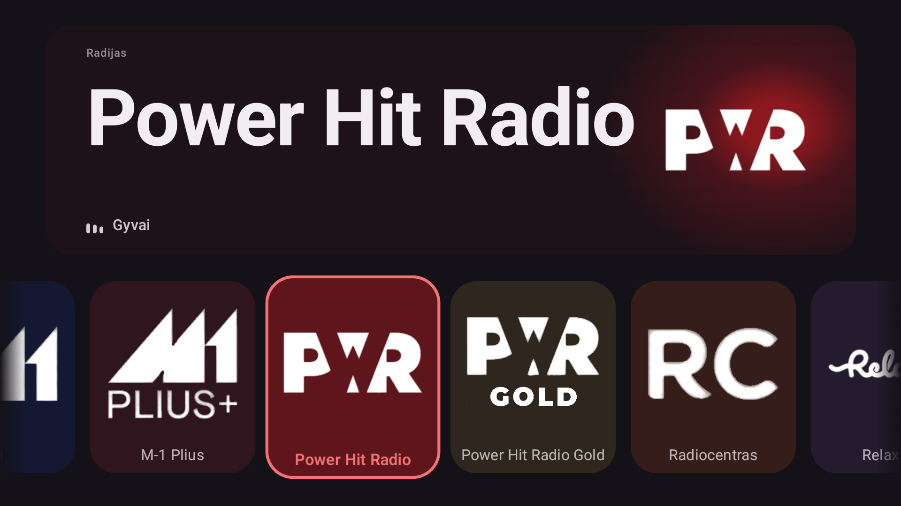
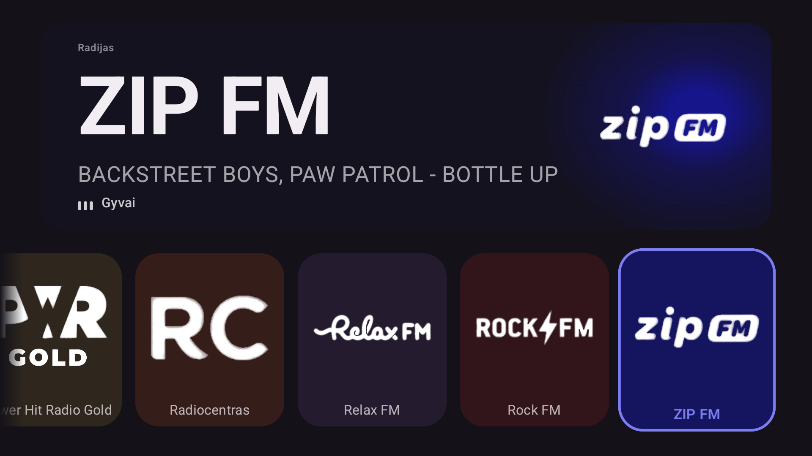

# Radijas

**Android TV radijo programėlė. Įjungi ir groja.**

Vienas ekranas, vienuolika Lietuvos stočių, jokio meniu. Skirta tiems, kuriems radijas televizoriuje turi įsijungti taip pat paprastai kaip televizijos kanalas.



## Kam tai skirta

Pirmiausia savo tėvams. Žmonėms, kuriems „atsisiųsk programėlę, prisijunk, pasirink stotį, tada dar kartą paspausk groti" yra per ilgas kelias iki garso. Jie neklauso radijo telefone ir neklauso jo kompiuteryje. Jie klauso jo virtuvėje, per televizorių, ir nori, kad tai veiktų taip, kaip veikė paprastas radijo imtuvas: paspaudei ir skamba.

Antra grupė yra visi kiti, kuriems nepatinka programėlių triukšmas. Žmonės, kurie nori vienos funkcijos be paskyrų, be naujienų ekrano, be „pažvelk į mūsų naujus nustatymus". Jei tai apie tave, ši programėlė veikia lygiai taip pat.

Trečia grupė yra tie, kurie tiesiog nori fono. Radijas per televizorių yra gera mintis: garsas kambaryje, ekranas gali būti išjungtas.

## Kaip atrodo

| | | |
|---|---|---|
|  |  |  |

Spalva ateina iš stoties ženklo. Perjungi stotį, persidažo visas ekranas: tamsiai žalia Lietui, raudona Rock FM, oranžinė Radiocentrui. Logotipai yra balti siluetai, kad būtų įskaitomi bet kurioje spalvoje ir iš sofos. Tai ne dekoracija: paletė apskaičiuojama taip, kad tekstas visada turėtų bent 4.5:1 kontrastą, ir tai tikrinama automatiškai visoms vienuolikai stočių.

## Ką daro

Atsidaro ir iškart groja paskutinę klausytą stotį. Pirmą kartą paleidus, groja Lietus.

Valdymas telpa į keturis pulto mygtukus:

| Mygtukas | Veiksmas |
|---|---|
| ← → | Rinktis stotį |
| OK | Groti |
| Back / Home | Išeiti ir nutildyti |
| ↑ ↓ | Nieko |

Stotys rikiuojamos A–Z: European Hit Radio, Gold FM, Lietus, M-1, M-1 Plius, Power Hit Radio, Power Hit Radio Gold, Radiocentras, Relax FM, Rock FM, ZIP FM. Paleidus groja paskutinė klausyta stotis, ne pirmoji sąraše; pirmą kartą — Lietus.

**Automatinis prisijungimas iš naujo.** Nutrūkus srautui, bandoma po 1, 2, 4, 8, 15 sekundžių, paskui kas 30 sekundžių, be galo. Ekrane rodoma „Bandau vėl…", o po pusės minutės be sėkmės atsiranda „Nepavyksta prisijungti. Paspausk OK.". Bandymai nesiliauja net tada, kai ekrane rodoma klaida, todėl naktį trumpam dingęs Wi-Fi atsigauna pats.

**„Kas groja".** Kai stotis siunčia dainos pavadinimą per ICY metadata, jis parodomas po stoties pavadinimu. Nefiltruojamas ir neapdorojamas: jei stotis siunčia reklamą, bus rodoma reklama. Jei stotis nesiunčia nieko, eilutė lieka tuščia, bet vieta išlieka, kad ekranas nešokinėtų.

## Ko sąmoningai nedaro

Nėra pauzės mygtuko. Nėra nustatymų ekrano. Nėra mėgstamų sąrašo, paieškos, ekvalaizerio, miego laikmačio, šviesios temos, kalbų pasirinkimo.

Kiekvienas papildomas ekranas yra vieta, kurioje vyresnis žmogus gali pasimesti, o kiekvienas papildomas nustatymas yra klausimas, į kurį jis turi atsakyti. Todėl jų nėra.

Pauzės atsisakyta ir dėl kitos priežasties. Jei sistema galėtų tyliai sustabdyti garsą, žmogus liktų sėdėti prie ekrano, kuris rašo „Gyvai", ir nieko negirdėtų. Programėlė tokios tylios būsenos nepalieka: jei garsą perima kita programėlė, ekrane taip ir parašoma, o ne toliau rodoma „Gyvai".

## Techninė dalis

### Karkasas

- **Kalba:** Kotlin 2.4.20. Visas kodas Kotlin, jokio Java.
- **UI:** Jetpack Compose su Compose for TV (`androidx.tv:tv-material` 1.1.0).
- **Garsas:** AndroidX Media3 1.11.0 (`ExoPlayer`, `MediaLibraryService`).
- **Build:** Gradle su Kotlin DSL, AGP 9.2.0, version catalog (`gradle/libs.versions.toml`).
- **Platforma:** `minSdk 24`, `targetSdk 36`, `compileSdk 37`. Vienas modulis `:app`.
- **Testai:** JUnit 4, Robolectric 4.16.1 ir Compose UI testai, paleidžiami JVM'e be emuliatoriaus.

Programėlė yra TV skirta ne tik pagal išvaizdą. Manifeste yra `android.software.leanback` su `required="true"`, `LEANBACK_LAUNCHER` kategorija ir 320×180 baneris, o `android.hardware.touchscreen` nurodytas kaip nebūtinas. Telefono launcheryje programėlės nėra.

### Kaip veikia garsas

Garsą groja `MediaLibraryService` su ExoPlayer. Servisas yra tame pačiame procese kaip UI, todėl būsena ir dainos pavadinimas perduodami tiesiogiai, be papildomo IPC sluoksnio.

Paleidus programėlę, ji prisijungia prie serviso per `MediaController`, perduoda stotį ir iškart paleidžia grojimą. Kiekviena stotis turi savo srauto URL, kuris saugomas kode kartu su stoties pavadinimu, ženklo resursu ir ženklo spalva. Jokio backend'o nėra.

**Kas groja** gaunamas taip: Media3, aptikęs ICY srauto meta intervalą, išskiria metaduomenis į atskirą taką su `MimeTypes.APPLICATION_ICY`. Tą taką dekoduoja `MetadataRenderer`, o rezultatas ateina kaip `IcyInfo`. Kadangi `MediaSession` jo į `MediaController` neperduoda, servisas ir UI keičiasi juo per mažą bendrą būsenos objektą tame pačiame procese. Tai paprasčiausias sprendimas, kuris veikia, ir jis tyčia neturi jokio papildomo tinklo ryšio: meta imami iš to paties srauto, kuris groja.

### Fokusas

Ekrane yra viena fokusuojama zona: horizontali stočių lentyna apačioje. Viršutinė „dabar groja" panelė yra tik informacija, ji neturi nei `clickable`, nei `focusable`. Todėl fokusas negali niekur „pabėgti", o ↑ ir ↓ nieko nedaro.

Lentyna nesisuka ratu. Prie pirmos stoties ← daugiau neveda. Vyresniam žmogui sąrašo vyniojimasis atrodo kaip gedimas, nes jis jau buvo pradžioje ir staiga vėl mato pabaigą.

Paleidžiant, lentyna pasislenka iki stoties, kuri tuoj gros, ir fokusas atsiduria ant jos. Pasirinkus kitą stotį, lentyna nejuda: fokusas jau yra ten, kur reikia, ir papildomas slinkimas tik sukeltų šuolį.

### Būsenos

Penkios būsenos, kurias žmogus gali pamatyti: „Jungiamasi…", „Gyvai", „Bandau vėl…", „Nepavyksta prisijungti. Paspausk OK." ir „Pristabdyta. Paspausk OK.". Jos apskaičiuojamos gryna funkcija iš grotuvo būsenos, laiko nuo paskutinio grojimo ir `playWhenReady` vėliavos. Funkcija neturi jokių Android priklausomybių, todėl testuojama be emuliatoriaus.

Būsenos išdėstytos taip, kad ekranas nešokinėtų: eilutė po stoties pavadinimu visada užima tą patį aukštį, o ekvalaizerio brūkšneliai tiesiog tampa permatomi, kai negroja. Skirtingos būsenos nekeičia maketo.

### Pranešimas ir išorinis valdymas

Pranešime yra stoties pavadinimas, daina ir vienas veiksmas: „Stabdyti". Jokio play, pauzės ar peršokimo.

Tai ne tik kosmetika. `MediaSession.Callback.onConnect` atskiria savo programėlės valdiklį nuo visų kitų. Savas `MediaController` gauna pilną komandų rinkinį, o Google Assistant, sistemos medijos valdymas ir kitos programėlės gauna tik skaitymo komandas. Be to, sistemos `PlaybackState` neturi play ar pauzės vėliavėlių, todėl „paleisk" ar „pauzė" per Assistant tiesiog neveikia.

### Testai

`app/src/test/` turi 78 testus, kurie paleidžiami be emuliatoriaus:

- fokuso elgsena lentynoje (pradinis fokusas, judėjimas, kraštai, ↑↓ ignoravimas),
- būsenų skaičiavimas ir perėjimų tvarka,
- paletės kontrastas visoms vienuolikai stočių,
- dainos pavadinimo apdorojimas,
- pranešimo veiksmai ir sesijos komandų ribojimas,
- paleidimo stotis, sustabdymo taisyklė ir tai, ar grįžus į programėlę srautas turi būti paleistas iš naujo,
- logotipų failų vientisumas (visi nepermatomi pikseliai balti),
- A–Z tvarka, Power duomenų šviežumas ir pastovus stoties logotipas keičiantis dainai bei grojimo būsenai,
- PCM lygio matavimas nekeičiant garso buferio.

2026-10-30 pakeitimų patikros įrodymai ir likę realaus TV patikrinimai — [patikros užrašuose](docs/2026-10-30-radio-update.md).

## Projekto struktūra

```
app/src/main/java/lt/radijas/tv/
  MainActivity.kt        vienintelis ekranas ir gyvavimo ciklas
  RadijasApp.kt
  StartupStation.kt      kurią stotį groti paleidus
  StopPolicy.kt          kada nutilti
  RelaunchPolicy.kt      ar grįžus į programėlę reikia paleisti srautą iš naujo
  data/                  stotys ir jų saugojimas
  player/                Media3 servisas, grotuvo valdymas, ICY meta
  ui/                    ekranas, lentyna, plytelė, būsenos, tema
assets/brand/            logotipo ir banerio šaltiniai (SVG)
docs/screenshots/        ekrano nuotraukos
```

## Sukūrimas iš šaltinio

APK surinkimui pakanka JDK 17; testams su Android 36 / Robolectric reikia **JDK 21**. Rekomenduojama viskam naudoti JDK 21 ir Android SDK su `platforms;android-37.0`.

```bash
git clone https://github.com/afda1/radijas.git
cd radijas
export JAVA_HOME=/kelias/iki/jdk-21
export ANDROID_HOME=/kelias/iki/android-sdk
./gradlew assembleDebug
adb install -r app/build/outputs/apk/debug/app-debug.apk
```

Testai:

```bash
./gradlew testDebugUnitTest
```

## Apribojimai

- **Tik lietuvių kalba.** Sąmoningai: vertimai į kitas kalbas atneštų kalbų pasirinkimą, o tai jau nustatymas.
- **Tik Android TV.** Telefone programėlė neinstaliuosis, nes manifestas to neleidžia.
- **Stočių sąrašas yra kode.** Jei stotis pakeičia srauto adresą, reikia naujos versijos. Tai sąmoningas sprendimas: nuotolinis sąrašas būtų antras tinklo šaltinis ir dar viena vieta, kuri gali sugesti.
- **„Kas groja" priklauso nuo stoties.** Kitoms stotims naudojami ICY metaduomenys; Power Hit Radio ir Gold dainą gauname iš jų oficialios svetainės kas 20 s, tik grojant. Nepavykus gauti šviežių duomenų eilutė lieka tuščia. Svetainės duomenys gali keliomis sekundėmis aplenkti garso buferį.
- **Visada stoties logotipas.** Albumų viršeliai ir jų paieška pašalinti: daina keičia tik teksto eilutę, o stoties ženklas išlieka pastovus tiek pagrindiniame bloke, tiek karuselėje.
- **Išbandyta viename realiame įrenginyje** (Telia DV8919X-LT, Android 14) ir Android TV emuliatoriuje. Kituose televizoriuose gali skirtis screensaverio ir Home mygtuko elgsena.
- **Dar nėra išleisto APK.** Šiuo metu programėlė statoma iš šaltinio.

## Privatumas

Nėra reklamų. Nėra analitikos. Nėra crash reporterių. Nėra paskyrų, prisijungimų ar sinchronizavimo. Nėra Google Play Services, Firebase ar kitų SDK, kurie siunčia duomenis.

Tinklo užklausos: pasirinktos radijo stoties garsas ir Power Hit Radio / Gold oficialios svetainės dainos JSON. Šie serveriai mato IP adresą. Muzikos katalogų paieškos, paveikslėlių atsisiuntimo ir viršelių talpyklos nėra. Paskyrų, reklamų SDK, identifikatorių ir analitikos nesiunčiame.

Subtili vizualizacija skaičiuoja tris naujausius grotuvo PCM garso lygius. Mikrofonas nenaudojamas, garsas neįrašomas ir niekur nesiunčiamas, `RECORD_AUDIO` leidimo nereikia. Programėlė naudoja `ACCESS_NETWORK_STATE`, kad žinotų, kada tinklas grįžo, ir `WAKE_LOCK` bei fono servisą, kad grotų užgesus ekranui.

## Kaip tai padaryta

Projektas sukurtas dirbtinio intelekto pagalba, žmogui vadovaujant.

- Pradinį kodą, testus ir dokumentaciją rašė **DeepSeek V4.1 Flash**, veikiantis per OpenCode agentą.
- 2026-10-30 EHR, A–Z, Power metaduomenų ir vizualizacijos pakeitimai — **GPT-6.1 Sol** per OpenCode, pagal žmogaus nurodymus; šio etapo UI tikrinta Android TV emuliatoriuje, ne fiziniame televizoriuje. Išbandyti albumų viršeliai vėliau žmogaus sprendimu pašalinti.
- Produkto sprendimus priėmė žmogus: kam skirta, kaip atrodo, ko sąmoningai nėra, kokia kiekvienos stoties spalva. Kiekvienas žingsnis buvo tikrinamas realiame televizoriuje, ne tik emuliatoriuje.
- Kiekvienas pakeitimas ėjo per atskirą peržiūrą: testai, specifikacijos atitikimas, kodo kokybė.

Tai nereiškia, kad kodas sugeneruotas ir pamirštas. Bet tai ir nėra rankų darbas nuo pirmos iki paskutinės eilutės. Jei ieškai projekto, kurį žmogus parašė pats, šis toks nėra, ir geriau žinoti iš anksto.

## Kreditai ir licencija

**Radijas** platinamas pagal [GPL-3.0-only](LICENSE).

Garso variklis, tai yra Media3 sesijos servisas, automatinio prisijungimo logika ir stočių katalogas, yra kilęs iš [Fogwave](https://github.com/kalarina-bit/Fogwave) (GPL-3.0-only, autorius kalarina-bit). Visa kita yra parašyta šiam projektui: televizoriaus interfeisas, dizaino sistema, fokuso modelis, logotipas, baneris ir testai.

Kadangi dalis kodo yra išvestinė, visa programėlė lieka GPL-3.0-only. Jei platini pakeistą versiją, turi pateikti ir jos išeities kodą.

---

## English

**Radijas** is an Android TV radio app for eleven Lithuanian stations. It opens and plays. One screen, four remote buttons, no menus, no accounts, no ads, no analytics.

The interface is built for elderly users: a single focusable row, no wrap-around, no settings, no pause control anywhere. The palette is derived from each station's brand colour and tested for WCAG 4.5:1 contrast. The playback service retries forever with backoff, so a network drop recovers on its own.

**Stack:** Kotlin 2.4.20, Jetpack Compose for TV, Media3/ExoPlayer 1.11.0, AGP 9.2.0, `minSdk 24`, `targetSdk 36`. Single module, version catalog, 78 JVM tests (including Robolectric UI tests).

**Privacy:** no ads, trackers, analytics, crash reporting or Play Services. Besides the selected radio stream, the app requests official Power Hit Radio song metadata. These providers see the device IP. There are no artwork searches, image downloads or artwork caches. The PCM level visualizer neither records nor transmits audio and needs no microphone permission.

Built on the [Fogwave](https://github.com/kalarina-bit/Fogwave) playback engine (GPL-3.0-only); the TV interface, design system, focus model and tests are original. Licensed GPL-3.0-only.

**Built with AI assistance:** the initial code, tests and documentation were written by DeepSeek V4.1 Flash running in OpenCode, under human direction. The 2026-10-30 updates were implemented with GPT-6.1 Sol in OpenCode and checked in an Android TV emulator. Product decisions and physical-device checks belong to the human maintainer.
