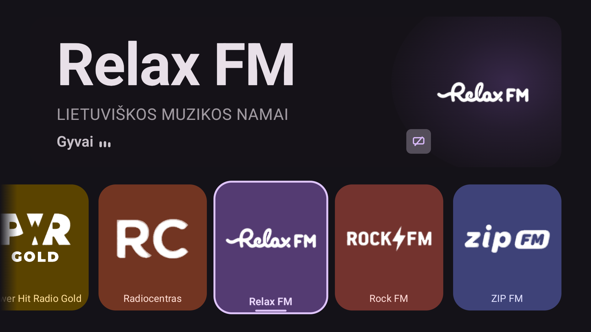
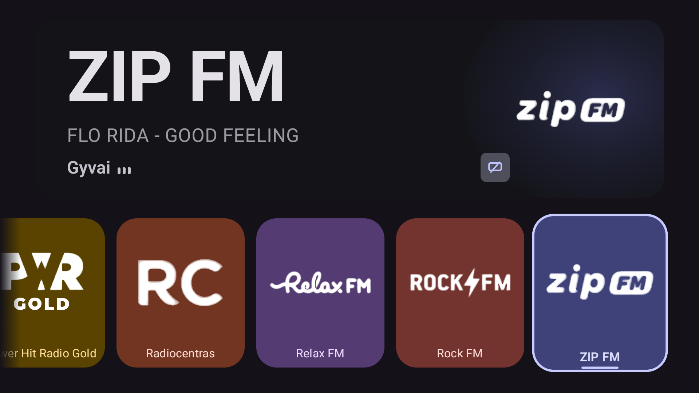
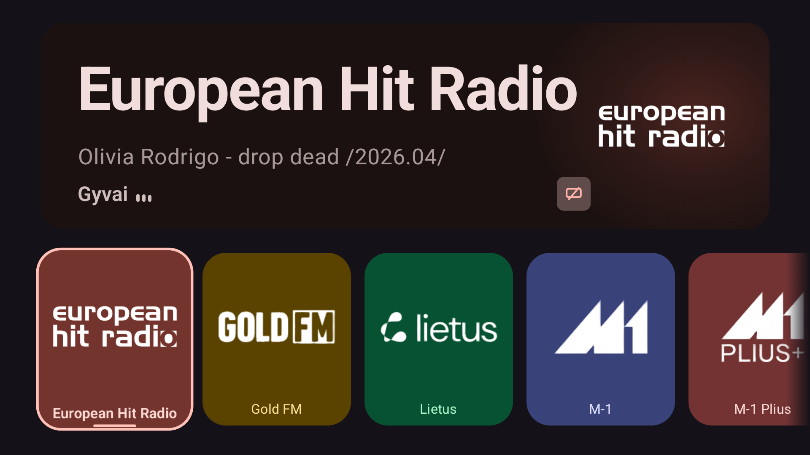

<div align="center">


# Radijas

**Įjungi ir groja.**

Lietuviškas radijas tavo Android TV: vienas ekranas, 11 stočių ir jokio meniu.

</div>



| Android TV emuliatoriuje | Realiame televizoriuje |
|---|---|
|  |  |

## Kam tai skirta?

Pirmiausia savo tėvams: žmonėms, kurie nori įsijungti radiją televizoriuje nesukdami galvos dėl paskyrų, meniu ar nustatymų. Ir visiems kitiems, kuriems norisi tiesiog klausytis.

## Ką gali?

- **Iškart groja** paskutinę klausytą stotį; pirmą kartą groja Lietus.
- **11 lietuviškų stočių**, kurias lengva pasirinkti televizoriaus pultu.
- **Automatiškai bando prisijungti iš naujo**, nutrūkus ryšiui.
- **Rodo, kas groja**, kai stotis pateikia dainos informaciją.
- **Pajuodina ekraną**, kai norisi tik garso. Tai juodas vaizdas, o ne fizinis ekrano išjungimas.
- **Jokių paskyrų, reklamų ar analitikos.** Radijo stočių ir metaduomenų serveriai mato įrenginio IP adresą.

## Kodėl taip paprastai?

Programėlė sukurta televizoriui ir valdymui pultu. Didelės, aiškios stotys, vienas ekranas ir jokio bereikalingo pasirinkimo padeda iki muzikos nueiti kuo mažiau žingsnių. Nėra nustatymų, paieškos ar pauzės mygtuko: paprastumas čia yra sąmoningas sprendimas.

## Kaip sukurta?

Projektas sukurtas **dirbtinio intelekto pagalba, žmogui vadovaujant**. Produkto ir dizaino sprendimus priėmė žmogus; kodas, testai ir dokumentacija rašyti pasitelkiant DI modelius per OpenCode. Programėlė tikrinta emuliatoriuje ir realiame Android TV įrenginyje.

Sukurta su **Kotlin**, **Jetpack Compose for TV** ir **Media3 / ExoPlayer**. Grojimo variklis ir stočių katalogas paremti [Fogwave](https://github.com/kalarina-bit/Fogwave).

## Įdiegimas

Išleisto APK kol kas nėra. Jį paskelbus, jis bus prieinamas [GitHub Releases](https://github.com/afda1/radijas/releases). Programėlei reikia Android TV ir interneto ryšio.

Norint sukurti iš kodo, reikia JDK 21 ir Android SDK su `platforms;android-37.0`:

```bash
./gradlew assembleDebug
./gradlew testDebugUnitTest
```

Windows sistemoje naudok `gradlew.bat`. Išleidimo informacija: [RELEASING.md](RELEASING.md).

---

Platinama pagal [GPL-3.0-only](LICENSE). Stočių pavadinimai ir ženklai priklauso jų savininkams; daugiau informacijos: [NOTICE](NOTICE).
